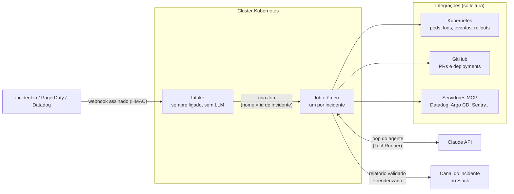
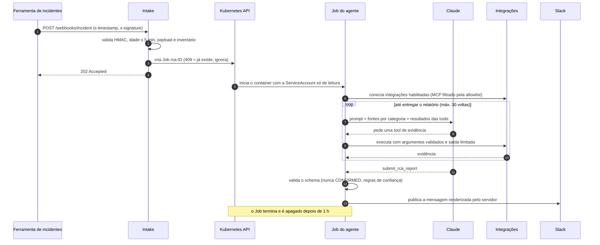

# sre-agent

Agente de plantão que investiga incidentes em produção e publica uma **hipótese de causa raiz** no Slack.
Ele só lê: não tem shell, não escreve em arquivo, não altera o cluster. Quem confirma a causa é uma pessoa.

Projeto de estudo de agentes de IA para SRE, construído com o [Anthropic TypeScript SDK](https://github.com/anthropics/anthropic-sdk-typescript) (Tool Runner) e Claude.

## Como funciona

### Visão geral



### Uma investigação, passo a passo



- **Intake** (`src/intake/`): o único processo sempre ligado. Autentica o webhook, valida o payload e cria um Kubernetes Job. O nome do Job vem do id do incidente, então o mesmo incidente nunca gera dois runs.
- **Job** (`src/job.ts`): um processo por incidente. Conecta as integrações, roda o agente, publica e termina.
- **Agente** (`src/agent/`): o Tool Runner do SDK cuida do loop. O agente termina chamando `submit_rca_report`, e o schema em `src/report/schema.ts` impõe as regras do relatório (nunca `CONFIRMED`, confiança limitada quando a mudança só "veio antes", evidência obrigatória).
- **Integrações** (`src/integrations/`): cada fonte de evidência é um módulo. Ver abaixo.

## Integrações

Toda integração implementa o mesmo contrato (`src/integrations/types.ts`) e declara de que **tipo de evidência** ela é fonte:

| Categoria | Pergunta que responde |
|---|---|
| `symptoms` | O que está quebrado? (estado, métricas, logs) |
| `changes` | O que mudou? (deploys, rollouts, PRs, config) |
| `errors` | Que erro a aplicação está dando? (exceções, contagens) |
| `context` | Já aconteceu antes? O que o time está falando? |

O prompt mostra ao agente as fontes agrupadas por categoria. Categoria sem fonte aparece como "nenhuma fonte disponível", e o agente é instruído a registrar isso como limitação em vez de supor.

Há dois tipos:

- **Nativa**: código deste repositório, com argumentos validados e saída limitada. Ex.: `kubernetes`, `github`.
- **MCP**: um servidor MCP pronto, declarado só no `agent.config.json`, com **allowlist obrigatória** de tools. Servidores MCP costumam expor tools de escrita (silenciar monitor, sincronizar app, reiniciar pipeline); só entram as que você listar.

Toda tool, nativa ou MCP, passa pelo mesmo teto de tamanho de saída.

### Catálogo planejado

| Integração | Categoria | Tipo provável | Prioridade | Observação |
|---|---|---|---|---|
| Kubernetes (qualquer cluster, inclusive GKE) | symptoms, changes | nativa ✅ | alta | Pods, logs, eventos, histórico de rollout. Substitui `kubectl`: sem shell |
| GitHub (repositórios) | changes | nativa ✅ | alta | PRs mergeados e deployments |
| Argo CD | changes | MCP ou nativa | alta | Histórico de sync é a melhor evidência de "o que foi para produção e quando" |
| Google Cloud: Logging, Monitoring, Audit Logs | symptoms, changes | nativa | alta | Audit Log mostra mudanças de infra e IAM; Monitoring cobre também Cloud SQL e GKE (nós, autoscaler) |
| Datadog | symptoms | MCP | alta | Métricas, monitores disparados, logs, APM |
| Sentry / Rollbar | errors | MCP | alta | Contagem de ocorrências costuma ser a evidência que fecha a causa |
| Slack (canal do incidente) | context | nativa | média | O que o time já descobriu durante o incidente |
| Post-mortems anteriores | context | nativa | média | Começar com busca em arquivos; vetores só se precisar |
| Feature flags (LaunchDarkly, Unleash...) | changes | MCP ou nativa | média | Flag ligada ou desligada é uma causa comum e invisível no deploy |
| CircleCI / GitHub Actions | changes | nativa | baixa | Só se o deploy acontece no CI; com Argo CD, ele já cobre |
| Cloud SQL / MongoDB | symptoms | nativa | baixa | **Só metadados**: queries lentas, conexões, replicação. Nunca ler dados da aplicação |

Regras para qualquer integração nova:
1. Credencial só de leitura e com o menor escopo possível. A garantia é a permissão da credencial, não o prompt.
2. Nada de shell ou CLI genérica (`kubectl`, `gcloud`, `mongosh`): cada operação vira uma tool com argumentos validados.
3. Janela de tempo, número de linhas e tamanho de saída limitados.
4. Banco de dados: só métricas e metadados, nunca dados de cliente.

### Como adicionar uma integração

**Servidor MCP pronto** (sem código):

```json
"integrations": {
  "datadog": {
    "type": "mcp",
    "purpose": "métricas, monitores disparados e logs do serviço",
    "categories": ["symptoms"],
    "transport": {
      "kind": "http",
      "url": "https://<endpoint MCP do fornecedor>",
      "headersFromEnv": { "DD-API-KEY": "DATADOG_API_KEY" }
    },
    "allowTools": ["<tool de leitura>", "<outra tool de leitura>"]
  }
}
```

Segredos nunca ficam no arquivo: `headersFromEnv` diz o **nome** da variável de ambiente. Se uma tool da allowlist não existir no servidor, o job falha no boot.

**Integração nativa**:

1. Crie `src/integrations/<nome>/client.ts` (a chamada à API externa) e `src/integrations/<nome>/index.ts` (as tools, com `betaZodTool`).
2. Registre em `NATIVE_INTEGRATIONS` (`src/integrations/registry.ts`).
3. Habilite no `agent.config.json`: `"<nome>": { "type": "native" }`.
4. Escreva o teste em `tests/`.

## Rodando localmente

Pré-requisitos: Node 22 (ou Docker), acesso a um cluster (pode ser `kind` ou `k3d`) e credencial da Anthropic (`ANTHROPIC_API_KEY` ou `ant auth login`).

```bash
npm install
cp .env.example .env
cp agent.config.example.json agent.config.json
npm test
```

Investigar um incidente de exemplo (usa o `~/.kube/config` e imprime a mensagem no stdout se não houver `SLACK_BOT_TOKEN`):

```bash
npm run job -- fixtures/incident.sample.json
```

Subir o intake em modo local (roda a investigação no mesmo processo):

```bash
npm run intake
```

Sem Node instalado, rode tudo pelo Docker:

```bash
docker run --rm -v "$PWD":/app -w /app node:22-slim sh -c "npm ci && npm test"
```

## Deploy

- `deploy/Dockerfile`: a mesma imagem serve o intake e o job.
- `deploy/k8s/rbac-readonly.yaml`: a ServiceAccount do job só tem `get`/`list` em pods, logs, eventos, deployments e replicasets. Sem secrets, sem `exec`. O intake só pode criar Jobs no próprio namespace.
- `deploy/k8s/intake.yaml`: Deployment do intake, ConfigMap com o `agent.config.json` e Service.

O webhook precisa enviar os cabeçalhos `x-timestamp` (epoch em segundos) e `x-signature` (`sha256=` + HMAC-SHA256 de `<timestamp>.<corpo>` com `WEBHOOK_SECRET`). Entregas com mais de 5 minutos são recusadas.

## Próximos passos

- [ ] Conjunto de avaliação: incidentes passados com a causa conhecida, para medir se o agente acerta
- [ ] Integrações de mudança: Argo CD e Google Cloud Audit Logs
- [ ] Integração de erros (Sentry ou Rollbar)
- [ ] Persistir casos e relatórios (Postgres) e deduplicar entre réplicas do intake
- [ ] Adaptadores de payload por fonte (incident.io, PagerDuty, Datadog)
